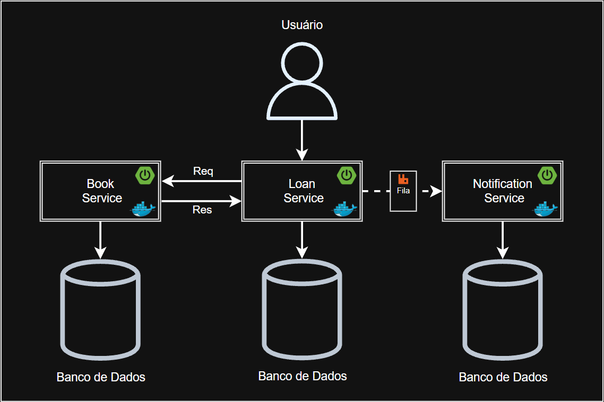

# Sistema de Gerenciamento de Biblioteca (Microsserviços)




---

### Descrição

Sistema de gerenciamento de biblioteca dividido em três microsserviços independentes, cada um com seu próprio banco de dados, seguindo arquitetura de microsserviços e arquitetura limpa, com comunicação síncrona via OpenFeign e assíncrona via mensageria. Um api-gateway centraliza o ponto de entrada do sistema, roteando as requisições para os serviços e agregando a documentação Swagger de todos eles.

O book-service cuida do cadastro, consulta e controle de disponibilidade dos livros. O loan-service autentica os usuários via JWT, cria e devolve empréstimos consultando e reservando a disponibilidade do livro em tempo real, e roda um job diário que identifica empréstimos em atraso e publica um evento. O notification-service consome esses eventos e envia o e-mail para o usuário do empréstimo.

O projeto aplica princípios do SOLID em toda a sua estrutura. No envio de notificações, por exemplo, o loan-service publica os eventos por meio de uma abstração, com implementações para RabbitMQ e para AWS SNS com entrega em filas SQS, e a tecnologia de mensageria pode ser trocada por configuração, sem alterar a lógica do serviço.

A pipeline de CI/CD usa GitHub Actions para compilar e testar os serviços, com deploy na AWS usando ECS e Fargate.

---

### Funcionalidades

- CRUD de livros com controle de cópias disponíveis.
- Cadastro, autenticação (JWT) e criação/devolução de empréstimos com verificação de disponibilidade em tempo real.
- Verificação diária de empréstimos em atraso via job agendado.
- Envio de e-mail de atraso ao usuário, processado de forma assíncrona via mensageria (RabbitMQ ou AWS SNS/SQS).
- Roteamento centralizado via api-gateway, com documentação Swagger agregada dos serviços.
- Testes automatizados, validação de dados, tratamento global de exceções e documentação via Swagger em cada serviço.

---

### Stack

- Java 21, Spring Boot 3.5.16
- Spring Data JPA, Spring Security, OAuth2 Resource Server (JWT)
- Spring Cloud OpenFeign
- Spring Cloud Gateway (Server WebMVC)
- Spring AMQP (RabbitMQ)
- Spring Cloud AWS (SNS e SQS)
- SQL Server, Flyway
- MapStruct, Lombok
- Springdoc OpenAPI (Swagger)
- Docker, Docker Compose
- GitHub Actions, LocalStack

---

### Endpoints

Todos os endpoints abaixo também podem ser acessados através do api-gateway, na porta `8080`.

#### book-service

- `GET /v1/books` — lista livros.
- `GET /v1/books/{id}` — busca um livro específico.
- `POST /v1/books` — cadastra um livro.
- `PUT /v1/books/{id}` — atualiza um livro.
- `DELETE /v1/books/{id}` — remove um livro.
- `PUT /v1/books/{id}/reserve` — reserva uma cópia.
- `PUT /v1/books/{id}/return` — libera uma cópia.

#### loan-service

- `POST /v1/auth/register` — registra um usuário.
- `POST /v1/auth/login` — autentica e retorna um token JWT.
- `GET /v1/loans` — lista empréstimos.
- `GET /v1/loans/{id}` — busca um empréstimo específico.
- `POST /v1/loans` — cria um empréstimo para o usuário autenticado.
- `PUT /v1/loans/{id}/return` — registra a devolução de um empréstimo.

---

### Instalação

#### Pré-requisitos

- Docker

#### Clone o repositório

```bash
git clone https://github.com/geovanegsfarias/library-management-microservices.git
cd library-management-microservices
```

#### Gere as chaves RSA

```bash
openssl genrsa -out loan-service/src/main/resources/app.key 2048
openssl rsa -in loan-service/src/main/resources/app.key -pubout -out loan-service/src/main/resources/app.pub
```

#### Configure as variáveis de ambiente

Crie um arquivo `.env` na raiz do projeto baseado no `.env.example` disponibilizado na raiz.

Por padrão, as notificações usam o RabbitMQ, que sobe junto com o Compose. Para usar SNS e SQS, é necessário ter o LocalStack rodando e criar o tópico, a fila e a inscrição antes de configurar o broker no `.env`.

#### Suba a aplicação

```bash
docker compose up --build
```

- API Gateway: `http://localhost:8080/swagger-ui.html`
- Book-Service: `http://localhost:8081/swagger-ui.html`
- Loan-Service: `http://localhost:8082/swagger-ui.html`
- Notification-Service: `http://localhost:8083`
- RabbitMQ Management: `http://localhost:15672`
